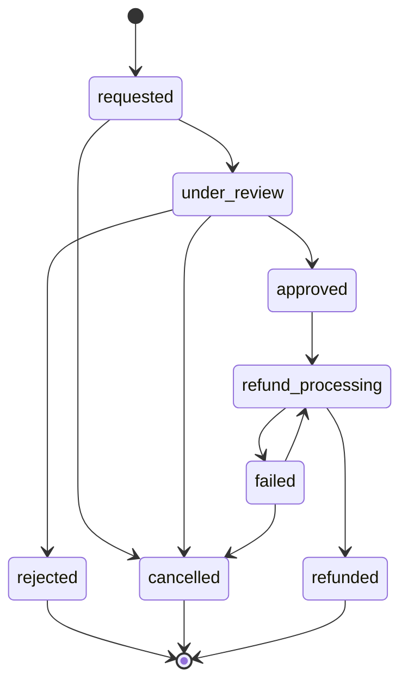

# Devoluciones de cursos y liquidación al propietario

Todo lo que hay que saber para operar, activar o revertir esta funcionalidad.

> **Estado.** El código está completo y probado. **Nada de esto está encendido
> en producción**: todas las banderas de dinero nacen apagadas y la comisión
> nace sin decidir. Lo que falta es de la empresa, no del código — ver
> [Pendientes externos](#pendientes-externos-de-la-empresa).

---

## La regla que manda

```
El proveedor confirma el dinero.
Z decide el acceso, la garantía, la devolución, la auditoría y el saldo.
```

Stripe **no** es la fuente de verdad del acceso. El acceso lo decide
`entitlements`, igual que desde la migración 0035. Un `refund.created` de
Stripe no revoca nada por sí solo.

Inspirado en las prácticas de **protección al comprador** de los marketplaces
—mediación, trazabilidad y liberación protegida de fondos— adaptadas a cursos
digitales. No se copian políticas de productos físicos ni se inventan
requisitos legales.

---

## 1. Reglas de negocio

### La garantía

| | |
|---|---|
| Duración | **exactamente 168 horas** (7 × 24) |
| Empieza | cuando el backend **entrega por primera vez contenido protegido** de una compra pagada |
| Reloj | **UTC**, hora del servidor |
| Procede si | `requested_at < expires_at` |
| En el instante exacto de vencimiento | **ya no procede** |

**No empieza** al pagar, al abrir la ficha del curso, al ver una muestra
gratuita, ni al cargar una pantalla que no entrega contenido protegido.
Tampoco la arrancan los cursos gratuitos, el acceso de autor, el de
administración ni el regalo de la beta: no hay nada que devolver.

El **porcentaje consumido no afecta la elegibilidad**. Se muestra a la
administración como contexto y nada más. Una solicitud que entró en plazo entra
en plazo, haya visto la persona una lección o todas.

`first_accessed_at` lo pone el servidor, se escribe **una sola vez** y no lo
mueven reinstalar, cambiar de dispositivo ni recomprar. Nunca llega del cliente:
una fecha que manda el móvil se puede retrasar para estirar el plazo.

### Una sola devolución

Un usuario recibe **como máximo un reembolso voluntario por curso**, durante
toda la vida de su cuenta.

Una solicitud **rechazada, cancelada o fallida NO consume** ese derecho.

Tras un reembolso con éxito:

- se revoca **solo** el acceso pagado (`entitlements` + compra heredada);
- se **conserva** la matrícula (`course_enrollments`);
- se **conserva** el progreso (`lesson_progress`);
- se puede volver a comprar, y la recompra **restaura el acceso y conserva el
  progreso anterior**;
- la recompra **no** tiene una segunda garantía.

Antes de recomprar hay que mostrar, y guardar que se aceptó: que ya recibió una
devolución, la fecha, que la nueva compra no tendrá devolución, y una casilla de
aceptación explícita. La aceptación queda auditada con la **versión y la huella
del texto exacto** que se mostró, y vinculada a la orden concreta.

Duplicación de cobro, fraude o cobro no reconocido son **incidencias de pago
separadas**, no una segunda devolución voluntaria.

### Cuándo se retira el acceso

Durante **solicitud, revisión, aprobación, procesamiento y fallo temporal** el
alumno **conserva el acceso**.

Se retira **solo** con un reembolso **total, confirmado y conciliado** con la
orden y el entorno correctos. Un reembolso pendiente, parcial o fallido **no
revoca nada**.

> Quitarle el curso a alguien antes de que el dinero le vuelva es lo peor que
> puede hacer esta funcionalidad: se queda sin las dos cosas.

El historial de compras y devoluciones **sigue accesible** aunque el acceso al
curso se haya revocado.

---

## 2. Diagrama de estados



Quién puede provocar cada transición:

| Transición | Actor |
|---|---|
| `under_review`, `approved`, `rejected` | **admin** |
| `cancelled` | **user** (la suya) o **admin** |
| `refund_processing` | **admin** (al aprobar) o **system** (reintento) |
| `refunded`, `failed` | **system**, y solo con webhook verificado |

**Ni un administrador puede declarar `refunded` a mano.** Eso retiraría el
acceso sin que nadie hubiera devuelto el dinero.

El **propietario del curso no aparece en ninguna transición**: no aprueba, no
rechaza y no ejecuta reembolsos.

Los estados **vivos** —`requested`, `under_review`, `approved`,
`refund_processing`, `failed`— bloquean abrir otra solicitud sobre la misma
orden. La lista vive en `estados.SQL_VIVOS` y de ahí salen tanto el índice
parcial como la inserción, para que no puedan divergir.

---

## 3. Permisos por rol

| Acción | Alumno | Propietario | Admin |
|---|:--:|:--:|:--:|
| Ver su garantía | ✅ | — | ✅ |
| Pedir devolución | ✅ (la suya) | — | — |
| Ver su solicitud | ✅ (la suya) | ❌ | ✅ |
| Retirar su solicitud | ✅ | — | ✅ |
| Ver la bandeja | ❌ | ❌ | ✅ |
| Tomar / aprobar / rechazar | ❌ | ❌ | ✅ |
| Reintentar / reconciliar | ❌ | ❌ | ✅ |
| Ver sus estudiantes | ❌ | ✅ (sus cursos) | ✅ |
| Ver sus ventas y saldos | ❌ | ✅ (sus cursos) | ✅ |
| Ver el motivo privado | ✅ (el suyo) | **❌ nunca** | ✅ |
| Ver notas internas de revisión | ❌ | **❌ nunca** | ✅ |

Todos los permisos se verifican **en el backend**. Ocultar un botón no es un
permiso.

### Qué nota lee el alumno, y cuál no

`review_notes` viaja en la respuesta del alumno, así que **solo puede contener
lo que se le dirige a él**: la justificación de una decisión humana. El campo se
escribe únicamente cuando administración **aprueba** o **rechaza**.

Cualquier otra nota —la de un `cancel`, el motivo técnico con el que la pasarela
rechazó el cargo— se guarda **solo en el historial**, que no sale del ámbito de
administración.

> Esta fila de la tabla de arriba era una intención, no una garantía. La nota se
> escribía en **cualquier** transición, así que el mensaje de error de Stripe
> acababa en la pantalla del alumno presentado como si lo hubiera escrito la
> persona que revisó su caso. No se ha perdido rastro: se ha perdido la
> publicación.

### Un 422 no es siempre «llegaste tarde»

La bandeja distinguía «el expediente ya no está en ese estado» por el **código
de respuesta**, y ahí el backend mete cosas muy distintas. Dos quedaban tapadas
bajo «otra persona lo movió, recarga»:

| Código | Qué es de verdad |
|---|---|
| `refund_not_reconciled` | La pasarela dice haber devuelto un importe que **no cuadra con la orden**. Es una alarma contable y hay que leerla entera. |
| `refund_reason_required` | Falta escribir el motivo del rechazo. Lo arregla quien está mirando la pantalla; recargar, no. |

Ahora la lista de conflictos es **cerrada** (`refund_invalid_transition`,
`refund_already_refunded`, `refund_no_external_reference`,
`refund_acceptance_not_needed`) y todo lo demás se muestra con su mensaje.

`_exigir_gestor` está en una sola función para que mañana pueda ser un permiso
propio (`refund_manager`) sin tocar ningún endpoint.

---

## 4. Endpoints

Prefijo `/api/v1`.

### Alumno

| Método | Ruta |
|---|---|
| `GET` | `/payments/courses/{course_id}/refund-eligibility` |
| `POST` | `/payments/refund-requests` |
| `GET` | `/payments/refund-requests/mine` |
| `GET` | `/payments/refund-requests/{id}` |
| `POST` | `/payments/refund-requests/{id}/cancel` |
| `GET` | `/payments/courses/{course_id}/repurchase-notice` |
| `POST` | `/payments/repurchase-acceptance` |
| `GET` | `/payments/history` |

El cliente manda **dos cosas y solo dos**: qué orden y por qué. Importe, moneda,
curso, plazo y elegibilidad los resuelve el servidor desde la orden. El esquema
de entrada ni siquiera admite un importe.

### Administración

| Método | Ruta |
|---|---|
| `GET` | `/admin/refund-requests` (paginada, filtros) |
| `GET` | `/admin/refund-requests/{id}` (con historial) |
| `POST` | `/admin/refund-requests/{id}/take` |
| `POST` | `/admin/refund-requests/{id}/approve` |
| `POST` | `/admin/refund-requests/{id}/reject` (motivo obligatorio) |
| `POST` | `/admin/refund-requests/{id}/retry` |
| `POST` | `/admin/refund-requests/{id}/cancel` |
| `POST` | `/admin/refund-requests/{id}/reconcile` |

### Propietario

| Método | Ruta |
|---|---|
| `GET` | `/learning/courses/{course_id}/students` |
| `GET` | `/commerce/courses/{course_id}/summary` |
| `GET` | `/commerce/courses/{course_id}/sales` |

---

## 5. Esquema de datos (migración 0049 — **aplicada**)

Siete tablas:

| Tabla | Para qué |
|---|---|
| `course_refund_windows` | cuándo empezó la garantía de una persona en un curso |
| `refund_requests` | la solicitud y su estado |
| `refund_request_events` | historial de transiciones (solo-añadir) |
| `refund_policy_acceptances` | «sé que esta recompra no tiene garantía», firmado |
| `owner_payout_accounts` | dónde cobra quien vende |
| `owner_sale_balances` | la fotografía inmutable de una venta |
| `owner_transfers` | los intentos de pagarle |

### Las seis invariantes, en la base

No en Python. Si la protección contra repeticiones se escribe como «mira si ya
existe y, si no, insértalo», dos peticiones simultáneas leen las dos antes de
que escriba ninguna y las dos insertan. En dinero eso es un reembolso pagado dos
veces.

| # | Invariante | Índice |
|---|---|---|
| 1 | Una garantía por (usuario, curso) | `course_refund_windows_unica` |
| 2 | Una solicitud **viva** por orden | `refund_requests_viva_por_orden` *(parcial)* |
| 3 | Un reembolso con **éxito** por (usuario, curso) | `refund_requests_exito_unico` *(parcial)* |
| 4 | Un saldo por orden | `owner_sale_balances_orden_unica` |
| 5 | Una transferencia **viva** por saldo | `owner_transfers_viva_por_saldo` *(parcial)* |
| 6 | Una aceptación por compra | `refund_policy_acceptances_unica` *(parcial)* |

Los parciales son parciales a propósito: **el historial no se puede perder**.
Rechazadas y canceladas puede haber muchas; vivas, una.

### RLS

Las siete tablas tienen RLS activada y **solo políticas de `SELECT`**. Ninguna
de escritura, ni siquiera para el dueño de la fila: con RLS activada y sin
política, la escritura queda negada para todo el que entre con la clave pública.
La API entra con la clave de servicio y es la única que escribe.

Dejar un `insert ... with check (user_id = auth.uid())` permitiría a cualquiera
crearse una fila de saldo desde el navegador con su propio id: correcta según la
política, y aun así **dinero inventado**.

### Dinero

Todos los importes en la **unidad menor** de la moneda y como **enteros**. Ni un
`numeric`, ni un `float`. Un céntimo de redondeo por mil ventas es una tarde de
conciliación.

---

## 6. Idempotencia

En tres capas, porque pagar dos veces no se puede deshacer.

| Capa | Mecanismo |
|---|---|
| **API** | una solicitud viva por orden; la segunda pulsación devuelve **la misma** solicitud, no un error |
| **Base** | índices únicos parciales; `on conflict do nothing`, nunca capturar el error |
| **Proveedor** | clave derivada de la solicitud **y del número de fallos terminales** |

**Por qué `on conflict do nothing` y no capturar `IntegrityError`.** Capturarlo
obliga a un `rollback`, y un rollback a media petición tira **todo lo demás** de
la transacción — incluida la entrega de la lección que estaba en curso.

**Concurrencia administrativa.** Comprobar el estado en Python no basta: dos
administradores leen `under_review`, los dos pasan la comprobación en memoria y
los dos escriben. La transición es un **`UPDATE` condicional** —comparar y
escribir en la misma sentencia—, así que el segundo afecta a cero filas y se
entera de a qué estado la movieron.

### La clave de idempotencia

    intento 0        zrefund_{solicitud}
    tras 1 terminal  zrefund_{solicitud}_r1
    tras 2           zrefund_{solicitud}_r2

**Por qué no puede ser siempre la misma.** El primer «no» de la pasarela queda
grabado contra esa clave: reintentar reenvía la misma y Stripe devuelve *la
misma respuesta fallida*, para siempre. El botón de reintentar no serviría nunca.

**Por qué no puede cambiar en cada intento.** Un tiempo de espera agotado no
significa que no se haya hecho. Clave nueva tras un timeout es exactamente cómo
se paga dos veces.

**De dónde sale el número.** De los eventos `failed` ya persistidos, clasificando
su `reason` con `es_terminal()` —la única función que decide esto—. Así
sobrevive a reinicios, vale igual para todos los procesos, y funciona en
PostgreSQL y en el SQLite de las pruebas sin consultar dentro de un `jsonb`. Los
eventos antiguos sin el metadato se clasifican igual por su motivo.

---

## 7. Reintentos

### Terminal o ambiguo

Lo decide `es_terminal()` en `payments/reembolsos.py`, y **solo ahí**.

| | Códigos | Estado en que queda | Clave del reintento |
|---|---|---|---|
| **Terminal** | lista blanca. Los seis motivos REALES de `Refund.failure_reason` en Stripe (`lost_or_stolen_card`, `expired_or_canceled_card`, `charge_for_pending_refund_disputed`, `insufficient_funds`, `declined`, `merchant_request`), los de expedientes anteriores (`card_declined`, `charge_already_refunded`, `charge_disputed`, `expired_or_canceled_authorization`, `charge_not_refundable`, `provider_refund_failed`) y los nuestros (`provider_not_configured`, `no_transaction`) | `failed` | **nueva** (`_r1`, `_r2`…) |
| **Ambiguo** | **todo lo demás**: cualquier `http_*`, `network_timeout`, `unreadable_response`, `unknown_status`, y `unknown` —lo que Stripe pone cuando ni él sabe qué pasó— | `refund_processing` | **la misma** |

**Terminal es una lista blanca, no «lo que no sea 5xx».** La primera versión
clasificaba al revés y daba por concluyente cualquier `4xx` — incluidos los que
significan justo que la operación *sí* está ocurriendo: un `409` es «hay otra
petición en curso con esa clave» y un `400` con `idempotency_error` es «esa
clave ya se usó y su reembolso existe». Tomarlos por terminales cambiaba la
clave en el reintento y creaba un **segundo reembolso**.

Un código HTTP describe el **transporte**, no la decisión de quien cobra. En la
duda, ambiguo: equivocarse hacia ahí cuesta un reintento que no hace nada;
hacia «terminal», un cobro duplicado.

**Y ninguna heurística.** Hubo dos, y las dos se han quitado. La segunda era la
peligrosa: daba por concluyente cualquier código que **contuviera un espacio**,
o sea cualquier motivo escrito en prosa. El mensaje de un tiempo de espera
agotado lleva espacios, así que un timeout podía acabar clasificado como
terminal, cambiar la clave y duplicar el reembolso. Ahora la clasificación es
una comparación contra la lista y nada más. El código externo se guarda
**saneado** (minúsculas, sin espacios, 64 caracteres) para poder auditarlo, pero
la decisión no se toma leyendo su forma.

La tabla completa de qué hacer con cada respuesta vive en
`reembolsos.recuperacion()`, que se prueba aparte:

| Respuesta | Acción |
|---|---|
| `succeeded` | aplicar, y solo tras conciliar importe, moneda y orden |
| `pending` | conciliar más tarde; no se toca el acceso |
| `failed` concluyente | se puede reintentar con clave **nueva** |
| `failed` ambiguo | mismo intento, **misma** clave |
| cualquier otra cosa | no se toca nada y no se crea otro reembolso |

Un fallo ambiguo **no** manda el expediente a `failed`: se anota y la solicitud
se queda en `refund_processing`, reintentable.

**Por qué ese estado y no `failed`.** Es donde el webhook puede cerrarlo sin
sobresaltos. `FAILED → REFUNDED` sí existe hoy —un aviso tardío puede confirmar
que el dinero volvió después de darse un intento por fallido—, pero mientras la
respuesta sea ambigua el expediente no ha fallado: sigue en marcha.

Una respuesta aceptada pero **sin identificador externo** se trata como fallo
ambiguo. Antes se daba por buena, y ahí nacía el callejón sin salida.

| Situación | Comportamiento |
|---|---|
| Doble pulsación | un solo reembolso |
| Timeout o 5xx | no se crea otro; se reanuda con la **misma** clave |
| Aceptado sin identificador | se trata como ambiguo, reintentable |
| Fallo terminal confirmado | intento nuevo, con clave nueva |
| Ya hay `external_refund_id` | **nunca** se crea otro: se concilia |
| Éxito | se impide cualquier intento nuevo |
| Dos administradores a la vez | un solo efecto externo |

### Ninguna combinación se queda sin salida

Al volver de `ejecutar_reembolso`, la solicitud solo puede estar en uno de estos
tres sitios, y los tres tienen acción:

| Estado y datos | Qué se puede hacer |
|---|---|
| `approved` (bandera de pasarela apagada) | ejecutar cuando se encienda |
| `failed` | reintentar (clave nueva) · cancelar |
| `refund_processing` **con** identificador | conciliar |
| `refund_processing` **sin** identificador | reintentar (misma clave) |
| `failed` **con** identificador | conciliar; si la pasarela confirma que ese reembolso murió, se suelta la referencia y se pide uno nuevo |

**Reejecutar desde `refund_processing` está serializado.** La transición a ese
estado es un `UPDATE` condicional, pero cuando ya se está *en* él esa transición
no corre, así que un reintento simultáneo de dos administradores no tendría
ninguna barrera: la clave de idempotencia sería la única defensa. Un segundo
`UPDATE` condicional —sobre estado, referencia nula y `updated_at`— deja pasar a
uno solo.

`retry` acepta `failed`, `approved` y `refund_processing`, y **no borra**
`external_refund_id`: si hay referencia, delega en la conciliación en vez de
pedir un segundo reembolso.

---

## 8. Reconciliación

Si un webhook se pierde o tarda, una solicitud no puede quedarse para siempre en
`refund_processing`.

- Acción administrativa **«Reconciliar»**: consulta al proveedor con el
  identificador externo.
- Y una función idempotente para solicitudes estancadas.
- Solo marca `refunded` cuando el proveedor confirme **éxito total**.
- Ante pendiente, parcial o fallo: **mantiene el acceso** y registra auditoría.
- No duplica devoluciones: reutiliza la misma transacción que el webhook.

---

## 9. Relación entre el saldo y la garantía

**El dinero retenido es la garantía.** Mientras el comprador puede pedir
devolución, ese importe no es del propietario. Pagarlo antes obligaría a
reclamárselo después.

```
pending    la garantía del comprador sigue corriendo
frozen     hay una solicitud de devolución en curso
eligible   venció sin reclamación: ya se puede pagar
cancelled  hubo reembolso: no hay nada que pagar
```

### El caso que había que corregir

Una compra que tarda más de siete días en entrar al curso:

1. el usuario compra;
2. no entra durante ocho días;
3. el proceso de liberación marca el saldo como elegible;
4. luego entra y **entonces** empieza la garantía;
5. el propietario podría cobrar con la garantía todavía abierta.

**Diseño aplicado:** una venta sujeta a garantía nace `pending` con
`available_at = NULL`; ningún proceso la convierte en elegible mientras sea
`NULL`; en el primer acceso protegido se crea la ventana y se actualiza
`available_at = expires_at`; solo después del vencimiento se libera.

### El saldo se fotografía al vender, no se calcula al pagar

Si el neto se resolviera al transferir —precio actual × comisión actual,
propietario actual—, cambiar cualquiera de las tres cosas **reescribiría el
pasado**: una venta de hace tres meses pasaría a deberle dinero a otra persona.

Si el saldo ya se transfirió cuando llega el reembolso, **no se inventa una
devolución contra el propietario**: se deja constancia y el caso pasa a
conciliación manual. Recuperar dinero ya pagado a un tercero es una decisión de
negocio, no algo que resuelva un webhook a las tres de la mañana.

---

## 10. Banderas

| Bandera | Valor de fábrica | Qué controla |
|---|:--:|---|
| `FEATURE_COURSE_REFUNDS` | `false` | garantía y solicitudes |
| `STRIPE_REFUNDS_ENABLED` | `false` | ejecutar el reembolso **contra la pasarela** |
| `STRIPE_CONNECT_ENABLED` | `false` | cuentas conectadas |
| `CREATOR_TRANSFERS_ENABLED` | `false` | transferir de verdad |
| `PLATFORM_FEE_BPS` | `-1` | comisión en puntos básicos |

`PLATFORM_FEE_BPS = -1` significa **sin configurar**, y no es cero a propósito:
con cero, olvidarse de ponerla haría que Z transfiriera el bruto —pagando de su
bolsillo la parte que le tocaba— y **ninguna prueba lo delataría**, porque el
resultado cuadra. Sin comisión configurada no se crea saldo y no se transfiere.

`FEATURE_COURSE_REFUNDS` y `STRIPE_REFUNDS_ENABLED` están separadas a propósito:
con la primera encendida y la segunda apagada, **el circuito interno entero
—solicitar, revisar, aprobar— se recorre sin que salga un céntimo**.

**Apagar una bandera no borra historial ni revoca accesos.**

Deshabilitar **nuevas compras** no impide **confirmar devoluciones ya en curso**:
son cosas distintas y sus guardianes están separados.

### Con `FEATURE_COURSE_REFUNDS` apagada

La bandera cierra **la entrada**, no las obligaciones ya contraídas. Hay dos
guardianes distintos y no se mezclan:

- `_exigir_esquema` — ¿está la 0049?
- `_exigir_solicitudes_nuevas` — ¿se admiten solicitudes nuevas? Solo lo usa
  crear una.

**La garantía SÍ arranca aunque la bandera esté apagada.** Es deliberado: si se
apaga después de una compra, el primer acceso tiene que escribir la ventana
igualmente. Sin ella, el saldo del propietario se queda con `available_at` nulo
y **no se libera nunca** — dinero de un tercero retenido sin fin por un
interruptor. La bandera cierra la entrada de solicitudes, no las obligaciones ya
contraídas.

| | Con la bandera apagada |
|---|:--:|
| Crear una solicitud nueva | ❌ rechazo controlado |
| **Arrancar la ventana de garantía en el primer acceso** | ✅ **sí, siempre** |
| El alumno ve su historial y sus solicitudes | ✅ |
| El alumno retira una solicitud viva | ✅ |
| Administración lista, abre y resuelve | ✅ |
| Administración reintenta y concilia | ✅ |
| Los webhooks se procesan | ✅ |
| El aviso de recompra sin segunda garantía | ✅ sigue exigiéndose |

Lo último importa: apagar la bandera **no** puede dejar recomprar sin el aviso a
quien ya gastó su garantía. Por eso el guardián de la aceptación de recompra no
mira la bandera.

> **Esta tabla decía lo contrario dos párrafos más arriba.** Ponía «Arrancar una
> garantía nueva: ❌» justo debajo del texto que explica por qué eso no puede
> ser. La fila estaba mal y el texto bien; queda corregida aquí para que no haya
> dos respuestas a la misma pregunta.

### La regla, sin ambigüedad

Apagar `FEATURE_COURSE_REFUNDS` significa **«no se admiten solicitudes
nuevas»**, y nada más. En concreto:

1. **Impide solicitudes nuevas.** `POST /payments/refund-requests` responde con
   un rechazo controlado, no con un error.
2. **No abandona las anteriores.** Una solicitud ya abierta se revisa, se
   aprueba, se rechaza, se ejecuta y se concilia igual.
3. **No impide webhooks, conciliación ni resolución.** El dinero ya cobrado se
   sigue atendiendo: apagar la venta no es dejar de responder por lo vendido.
4. **La ventana de garantía se registra igual.** Si existe una compra sujeta a
   garantía, su primer acceso escribe la ventana. Sin ella, el saldo del
   propietario se queda con `available_at` nulo y **no se libera nunca**: dinero
   de un tercero retenido sin fin por un interruptor.
5. **Una bandera no borra una obligación adquirida.** Es la frase que resume las
   cuatro anteriores, y la que decide cualquier caso que no esté en esta lista.

Y su reverso, que también hay que decir: apagar la bandera **no** convierte una
compra vieja en irreversible. Lo que se prometió al vender se sigue debiendo.

Si de verdad falta la **migración**, eso sí responde de forma controlada: es
otra cosa y tiene su propio guardián.

---

## 11. Activación en staging

Por orden, y comprobando entre paso y paso:

1. La migración `0049` ya está aplicada. **No volver a aplicarla.**
2. **Reiniciar la API.** `esquema.py` cachea por proceso si las tablas existen;
   sin reiniciar seguiría respondiendo «no está».
3. Encender `FEATURE_COURSE_REFUNDS`. Recorrer: comprar → entrar a una lección
   protegida → ver la tarjeta de garantía → solicitar → revisar → aprobar.
   Con `STRIPE_REFUNDS_ENABLED` apagado, la aprobación queda pendiente de
   habilitación y **no sale dinero**.
4. Decidir y configurar `PLATFORM_FEE_BPS`. Sin esto no hay saldos.
5. Encender `STRIPE_REFUNDS_ENABLED` solo cuando la empresa tenga cuenta,
   credenciales y webhooks registrados.
6. `STRIPE_CONNECT_ENABLED` y `CREATOR_TRANSFERS_ENABLED` al final, y por
   separado.

---

## 12. Checklist de Stripe para la empresa

Ninguno de estos puntos lo puede hacer el código:

- [ ] Cuenta de Stripe disponible en el país de operación
- [ ] Verificación empresarial completada
- [ ] Credenciales de **sandbox** entregadas
- [ ] Credenciales de **producción** entregadas
- [ ] Webhook registrado apuntando a `/api/v1/payments/webhook/stripe`
- [ ] Secreto de firma del webhook configurado
- [ ] Eventos suscritos: `checkout.session.*`, `charge.refunded`, `refund.created`, `refund.updated`, `refund.failed`
- [ ] Stripe Connect habilitado
- [ ] Onboarding financiero de los propietarios
- [ ] **Comisión de la plataforma decidida** (es una decisión de negocio)
- [ ] Validación en sandbox con su cuenta
- [ ] Validación en producción con un importe pequeño real

**No se ponen secretos ni valores reales en este repositorio.**

---

## 13. Webhooks

- Firma verificada siempre. **Firma inválida falla en cerrado.**
- Eventos repetidos son idempotentes (`payment_events.external_event_id`).
- Eventos fuera de orden **no** retroceden estados.
- Eventos desconocidos se auditan y se ignoran de forma segura.
- **Sandbox nunca modifica producción**, y al revés.
- No se registran secretos ni cuerpos sensibles en los logs.

### La traducción de eventos, corregida

Los tres eventos de devolución se traducían a `refunded` **por su nombre**:

```python
"charge.refunded": "refunded",
"refund.created":  "refunded",   # significa «se ha pedido», no «ha vuelto»
"refund.updated":  "refunded",
```

Con esa tabla, un reembolso **pendiente** retiraba el acceso antes de devolver
un céntimo; uno **fallido** lo retiraba igual; y uno **parcial de 1 sobre 199**
quitaba el curso entero.

Ahora el estado sale del **contenido** del evento, no de su nombre. Solo un
reembolso completado **y total** se traduce a `refunded`. Un estado que Stripe
añada mañana cae en «en trámite», que es el lado seguro.

---

## 14. Rollback

1. Apagar `CREATOR_TRANSFERS_ENABLED`.
2. Apagar `STRIPE_CONNECT_ENABLED`.
3. Apagar `STRIPE_REFUNDS_ENABLED` (deja de ejecutarse contra la pasarela).
4. Apagar `FEATURE_COURSE_REFUNDS` (deja de aceptar solicitudes nuevas).
5. Si hiciera falta, apagar `STRIPE_PAYMENTS_ENABLED` (deja de aceptar compras).

**Lo que el rollback NO hace, y es deliberado:** no borra historial, no borra
auditoría, no borra progreso, no borra datos financieros y **no revoca accesos**.

Deshacer la migración solo si se decide abandonar la funcionalidad; el orden
está en la cabecera de `0049`. Se pierde el historial de devoluciones y nada más.

---

## 15. Monitoreo, logs y alertas

Qué vigilar, y por qué cada uno:

| Señal | Por qué importa |
|---|---|
| Solicitudes en `refund_processing` más de 24 h | webhook perdido: hay que reconciliar |
| Solicitudes en `failed` | la pasarela rechazó; alguien tiene que decidir |
| Saldos `pending` con `available_at` nulo y más de 30 días | compras que nadie abrió nunca |
| Saldos en `frozen` mucho tiempo | expedientes que nadie resuelve |
| `refund_parcial` en los logs | alguien devolvió de más o de menos a mano |
| `provider_not_configured` | se aprobó con la ejecución externa apagada |

Todos los logs del módulo van a `renaser.refunds`, `renaser.payments` y
`renaser.commerce`. **Nunca se registran** secretos, tokens, cuerpos de webhook
completos ni datos de pago.

### Dónde se miran las dos primeras señales

`GET /api/v1/admin/owner-balances/health?dias=30`, solo para administración y
comprobado en el servidor. Devuelve el dinero por estado, cuántos saldos están
`pending` **sin fecha de vencimiento** —compras que nadie llegó a abrir, así que
la garantía no ha arrancado y el dinero no tiene cuándo liberarse—, cuántos de
esos llevan más de `dias`, y cuántos congelados no se mueven desde hace más de
`dias`. Sin la 0049 responde ceros, no un 500.

Las demás señales siguen siendo consultas a mano sobre los logs.

---

## 16. Reembolso, disputa y contracargo: tres cosas distintas

Se confunden con facilidad y se resuelven de forma opuesta, así que conviene
tenerlas separadas por escrito.

| | **Reembolso** | **Disputa (contracargo)** |
|---|---|---|
| Quién lo inicia | la persona, con el botón | su **banco**, a petición suya |
| Por dónde entra | nuestro circuito, revisado por una persona | fuera: Stripe nos avisa cuando ya ocurrió |
| Consume la garantía | sí | **no** |
| Retira el acceso | sí, al confirmarse total | **no automáticamente** |
| Efecto en el saldo | lo **cancela** | lo **retiene** |
| Se puede negociar | no aplica | sí: hay que aportar pruebas a Stripe |

**Contracargo** es el nombre bancario de lo que Stripe llama *dispute*. Aquí se
usan como sinónimos.

### Qué hace Z cuando llega una disputa

Los tres eventos que se atienden son `charge.dispute.created`,
`charge.dispute.funds_withdrawn` y `charge.dispute.closed`. Al llegar cualquiera
de ellos:

1. Se localiza la orden por el cobro.
2. Se **retiene** el saldo del propietario si todavía no ha salido. La retención
   se marca **sin solicitud asociada** (`frozen_by_request_id` nulo), y por eso
   resolver una devolución cualquiera no la levanta por accidente.
3. **No se retira el acceso** y **no se consume la garantía**. Abrir una disputa
   no es haberla perdido: quitar el curso al abrirse castigaría a quien puede
   acabar ganándola, y esa decisión no es de un webhook.
4. Se registra el aviso completo en `payment_events` y se emite una alerta de
   nivel `error` en `renaser.payments`.

### Cómo se resuelve

| Desenlace | Qué hay que hacer, a mano |
|---|---|
| **Se gana** | Stripe devuelve el dinero. El saldo se descongela con `descongelar(order_id, refund_request_id=None)`. El acceso nunca se tocó, así que no hay nada que restaurar. |
| **Se pierde** | El dinero ya salió por fuera. Hay que cancelar el saldo (`cancelar`) y decidir **explícitamente** si se retira el acceso: no lo hace ningún automatismo, porque un contracargo perdido no siempre es un fraude. |
| **Se pierde con el saldo ya transferido** | Queda para conciliación manual, igual que un reembolso tardío. Recuperar dinero ya pagado a un tercero es una decisión de negocio, no de un webhook a las tres de la mañana. |

**Lo que NO se ha construido, a propósito**: no hay panel de disputas, ni envío
automático de pruebas a Stripe, ni control de plazos. Con el volumen actual
—cero compras reales— sería un subsistema entero para un caso que aún no existe.

---

## 17. Transferencias a creadores: qué hay y qué falta

Está **entera la arquitectura y apagada la ejecución**. Nada de esto mueve un
céntimo hasta que la empresa decida cuatro cosas.

**Lo que existe y está probado** (`commerce/transferencias.py`,
`commerce/stripe_transfers.py`, `commerce/liquidacion.py`):

- Contrato `TransferProvider` con dos operaciones: crear y consultar.
- Adaptador real de Stripe Connect, que falla en cerrado sin credenciales.
- Doble determinista para pruebas y staging, que recuerda las claves vistas.
- Clave de idempotencia **estable por saldo**, que solo cambia tras un fallo
  concluyente. Misma regla que en los reembolsos y por el mismo motivo.
- Ejecución exclusiva con **UPDATE condicional**: dos procesos no pagan dos veces.
- Persistencia del identificador real (`tr_...`), validado antes de guardarlo.
- Estados: `processing` → `completed` / `failed` en `owner_transfers`, y
  `eligible` → `transferring` → `transferred` en el saldo.
- Conciliación con la pasarela para lo que se quedó en marcha.
- Reintentos seguros: un fallo ambiguo repite clave; uno concluyente la cambia.

> **Nota de vocabulario.** La 0049 fija los estados de `owner_transfers` en
> `processing | completed | failed | cancelled`. El proveedor dice `succeeded`;
> la traducción a `completed` ocurre en un solo sitio (`liquidacion._asentar`)
> para no arrastrar dos vocabularios sueltos. **No hace falta migración nueva.**

**Las puertas que hay que pasar para que salga dinero**, todas comprobadas en el
backend y ninguna en el cliente:

| Puerta | Código del motivo |
|---|---|
| Bandera de transferencias encendida | `transfers_disabled` |
| Connect encendido | `connect_disabled` |
| Comisión configurada (`≥ 0`) | `fee_not_configured` |
| El saldo está `eligible` | `not_eligible` |
| Hay algo que pagar | `nothing_to_transfer` |
| La garantía ya empezó | `guarantee_not_started` |
| La garantía ya venció | `guarantee_open` |
| No hay ninguna solicitud viva | `refund_request_open` |
| La orden sigue pagada | `order_not_payable` |
| La cuenta conectada admite pagos | `payout_account_not_ready` |
| El onboarding está terminado | `onboarding_incomplete` |
| La cuenta es la **del propietario de esa venta** | `payout_account_mismatch` |

**Lo que falta, y no es ingeniería:**

1. Cuenta de Stripe de la empresa, verificada.
2. Stripe Connect habilitado y el tipo de cuenta elegido (Express o Custom).
3. El onboarding de cada creador, con su cuenta conectada.
4. **`PLATFORM_FEE_BPS`.** Sin ese número no se crea ningún saldo y no se
   transfiere a nadie. `-1` no es «cero por ciento»: es «nadie lo ha decidido».

**Lo que queda por conectar cuando eso llegue**: no hay tarea programada ni
endpoint que llame a `liberar_vencidos`, `ejecutar_transferencia` ni
`conciliar_transferencia`. Están probadas y sin llamante. Tampoco hay un panel
de administración que enseñe los saldos por estado y antigüedad, que es lo que
haría visible la señal «`pending` con `available_at` nulo» de la sección 15.

---

## 18. De dónde salen estos principios

La arquitectura se inspira en cómo funciona la **garantía de operaciones de
Alibaba**: el dinero del vendedor no es suyo hasta que la operación se considera
cerrada, una reclamación abierta lo retiene, la plataforma media, y todo
movimiento deja rastro.

Es una referencia de **principios**, y conviene decir lo que no es:

- **No es una dependencia.** No hay integración, ni acuerdo, ni servicio de por
  medio.
- **No es su política.** Las reglas de un producto físico —plazos de envío,
  inspección, devolución de mercancía— no aplican a un curso digital y no se han
  copiado.
- **No es su nombre.** «Trade Assurance» y «escrow» no aparecen en ninguna
  pantalla, ni deben: son términos ajenos, y el segundo tiene además un
  significado legal concreto que Z no está afirmando cumplir.

La política que manda es la de Z, la de la sección 1.

---

## 19. Protección y retención de datos

- **Nunca se registran** secretos, tokens, cuerpos de webhook completos,
  correos, `payment_intent` enteros ni datos de tarjeta. Los metadatos de
  `refund_request_events` son códigos e identificadores.
- **La explicación del alumno es privada.** El propietario del curso no la ve
  nunca; solo administración.
- **`review_notes` solo lleva lo que se le dirige al alumno**: la justificación
  de aprobar o rechazar. Todo lo demás vive en el historial (sección 3).
- **Los importes van en unidad menor y en enteros.** No hay `float` en ninguna
  parte del circuito.
- **Ningún valor financiero sale del cliente.** Importe y moneda se leen de la
  orden; el precio del checkout se construye en el servidor.
- **Retención**: los registros financieros y de auditoría no deberían
  desaparecer al borrar un perfil o un curso. El plazo concreto es una decisión
  legal, no técnica, y **sigue pendiente**: no se ha inventado ninguno.

---

## 20. Limitaciones conocidas

- **Solo web.** Comprar y devolver por la web. La preparación de RevenueCat,
  Apple y Google sigue intacta y no se ha tocado.
- **Sin transferencias reales** hasta que Connect esté habilitado y la comisión
  decidida. La arquitectura está entera y probada (sección 17); lo que falta son
  las cuatro decisiones de la empresa y enganchar las funciones a una tarea.
- **Sin panel de saldos.** Hay una consulta de administración
  (`/admin/owner-balances/health`) pero no una pantalla: se mira con una
  petición, no desde la aplicación.
- **Disputas al mínimo**: se reconocen, retienen el saldo y avisan. No hay panel
  ni envío de pruebas (sección 16).
- **Reembolso parcial**: se detecta, se audita y **no** revoca acceso, pero no
  se resuelve solo. Lo tiene que mirar una persona.
- **Saldo ya transferido cuando llega el reembolso**: queda para conciliación
  manual, por diseño.
- **Retención de datos**: los registros financieros y de auditoría no deberían
  desaparecer por borrar un perfil o un curso. La decisión de qué plazo aplicar
  es legal, no técnica, y **está pendiente** — no se ha inventado ninguno.

---

## Pendientes externos (de la empresa)

Estos puntos **no dependen del código** y bloquean la activación real:

1. Disponibilidad y apertura de la cuenta de Stripe.
2. Credenciales de sandbox y de producción.
3. Verificación empresarial.
4. Cuentas de Stripe Connect para los propietarios.
5. Configuración y registro de los webhooks.
6. **Definición de la comisión de la plataforma.**
7. Configuración del entorno de producción.

Hasta que existan, el circuito interno se puede recorrer entero con el doble
determinista y **sin mover dinero**.
