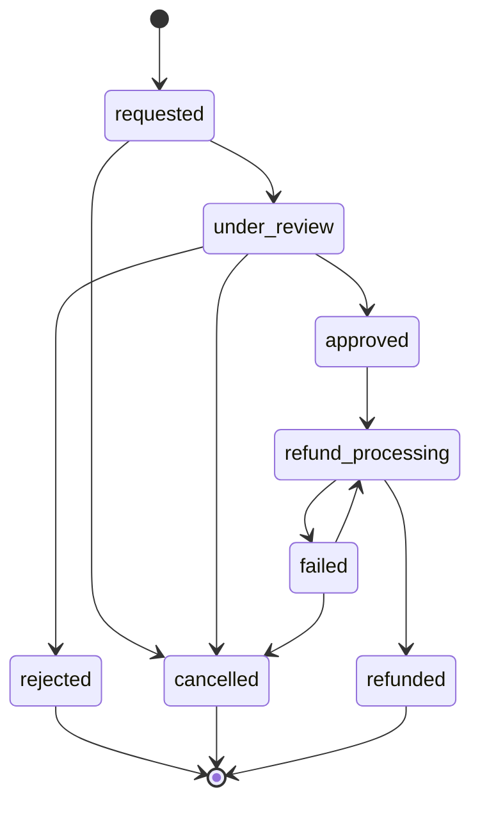

# Devoluciones de cursos y liquidación al propietario

Todo lo que hay que saber para operar, activar o revertir esta funcionalidad.

> **Estado.** El código está completo y probado. **Nada de esto está encendido
> en producción**: todas las banderas de dinero nacen apagadas y la comisión
> nace sin decidir. Lo que falta es de la empresa, no del código — ver
> [Pendientes externos](#pendientes-externos-de-la-empresa).

---

## La regla que manda

```
El proveedor confirma el dinero.
Z decide el acceso, la garantía, la devolución, la auditoría y el saldo.
```

Stripe **no** es la fuente de verdad del acceso. El acceso lo decide
`entitlements`, igual que desde la migración 0035. Un `refund.created` de
Stripe no revoca nada por sí solo.

Inspirado en las prácticas de **protección al comprador** de los marketplaces
—mediación, trazabilidad y liberación protegida de fondos— adaptadas a cursos
digitales. No se copian políticas de productos físicos ni se inventan
requisitos legales.

---

## 1. Reglas de negocio

### La garantía

| | |
|---|---|
| Duración | **exactamente 168 horas** (7 × 24) |
| Empieza | cuando el backend **entrega por primera vez contenido protegido** de una compra pagada |
| Reloj | **UTC**, hora del servidor |
| Procede si | `requested_at < expires_at` |
| En el instante exacto de vencimiento | **ya no procede** |

**No empieza** al pagar, al abrir la ficha del curso, al ver una muestra
gratuita, ni al cargar una pantalla que no entrega contenido protegido.
Tampoco la arrancan los cursos gratuitos, el acceso de autor, el de
administración ni el regalo de la beta: no hay nada que devolver.

El **porcentaje consumido no afecta la elegibilidad**. Se muestra a la
administración como contexto y nada más. Una solicitud que entró en plazo entra
en plazo, haya visto la persona una lección o todas.

`first_accessed_at` lo pone el servidor, se escribe **una sola vez** y no lo
mueven reinstalar, cambiar de dispositivo ni recomprar. Nunca llega del cliente:
una fecha que manda el móvil se puede retrasar para estirar el plazo.

### Una sola devolución

Un usuario recibe **como máximo un reembolso voluntario por curso**, durante
toda la vida de su cuenta.

Una solicitud **rechazada, cancelada o fallida NO consume** ese derecho.

Tras un reembolso con éxito:

- se revoca **solo** el acceso pagado (`entitlements` + compra heredada);
- se **conserva** la matrícula (`course_enrollments`);
- se **conserva** el progreso (`lesson_progress`);
- se puede volver a comprar, y la recompra **restaura el acceso y conserva el
  progreso anterior**;
- la recompra **no** tiene una segunda garantía.

Antes de recomprar hay que mostrar, y guardar que se aceptó: que ya recibió una
devolución, la fecha, que la nueva compra no tendrá devolución, y una casilla de
aceptación explícita. La aceptación queda auditada con la **versión y la huella
del texto exacto** que se mostró, y vinculada a la orden concreta.

Duplicación de cobro, fraude o cobro no reconocido son **incidencias de pago
separadas**, no una segunda devolución voluntaria.

### Cuándo se retira el acceso

Durante **solicitud, revisión, aprobación, procesamiento y fallo temporal** el
alumno **conserva el acceso**.

Se retira **solo** con un reembolso **total, confirmado y conciliado** con la
orden y el entorno correctos. Un reembolso pendiente, parcial o fallido **no
revoca nada**.

> Quitarle el curso a alguien antes de que el dinero le vuelva es lo peor que
> puede hacer esta funcionalidad: se queda sin las dos cosas.

El historial de compras y devoluciones **sigue accesible** aunque el acceso al
curso se haya revocado.

---

## 2. Diagrama de estados



Quién puede provocar cada transición:

| Transición | Actor |
|---|---|
| `under_review`, `approved`, `rejected` | **admin** |
| `cancelled` | **user** (la suya) o **admin** |
| `refund_processing` | **admin** (al aprobar) o **system** (reintento) |
| `refunded`, `failed` | **system**, y solo con webhook verificado |

**Ni un administrador puede declarar `refunded` a mano.** Eso retiraría el
acceso sin que nadie hubiera devuelto el dinero.

El **propietario del curso no aparece en ninguna transición**: no aprueba, no
rechaza y no ejecuta reembolsos.

Los estados **vivos** —`requested`, `under_review`, `approved`,
`refund_processing`, `failed`— bloquean abrir otra solicitud sobre la misma
orden. La lista vive en `estados.SQL_VIVOS` y de ahí salen tanto el índice
parcial como la inserción, para que no puedan divergir.

---

## 3. Permisos por rol

| Acción | Alumno | Propietario | Admin |
|---|:--:|:--:|:--:|
| Ver su garantía | ✅ | — | ✅ |
| Pedir devolución | ✅ (la suya) | — | — |
| Ver su solicitud | ✅ (la suya) | ❌ | ✅ |
| Retirar su solicitud | ✅ | — | ✅ |
| Ver la bandeja | ❌ | ❌ | ✅ |
| Tomar / aprobar / rechazar | ❌ | ❌ | ✅ |
| Reintentar / reconciliar | ❌ | ❌ | ✅ |
| Ver sus estudiantes | ❌ | ✅ (sus cursos) | ✅ |
| Ver sus ventas y saldos | ❌ | ✅ (sus cursos) | ✅ |
| Ver el motivo privado | ✅ (el suyo) | **❌ nunca** | ✅ |
| Ver notas internas de revisión | ❌ | **❌ nunca** | ✅ |

Todos los permisos se verifican **en el backend**. Ocultar un botón no es un
permiso.

`_exigir_gestor` está en una sola función para que mañana pueda ser un permiso
propio (`refund_manager`) sin tocar ningún endpoint.

---

## 4. Endpoints

Prefijo `/api/v1`.

### Alumno

| Método | Ruta |
|---|---|
| `GET` | `/payments/courses/{course_id}/refund-eligibility` |
| `POST` | `/payments/refund-requests` |
| `GET` | `/payments/refund-requests/mine` |
| `GET` | `/payments/refund-requests/{id}` |
| `POST` | `/payments/refund-requests/{id}/cancel` |
| `GET` | `/payments/courses/{course_id}/repurchase-notice` |
| `POST` | `/payments/repurchase-acceptance` |
| `GET` | `/payments/history` |

El cliente manda **dos cosas y solo dos**: qué orden y por qué. Importe, moneda,
curso, plazo y elegibilidad los resuelve el servidor desde la orden. El esquema
de entrada ni siquiera admite un importe.

### Administración

| Método | Ruta |
|---|---|
| `GET` | `/admin/refund-requests` (paginada, filtros) |
| `GET` | `/admin/refund-requests/{id}` (con historial) |
| `POST` | `/admin/refund-requests/{id}/take` |
| `POST` | `/admin/refund-requests/{id}/approve` |
| `POST` | `/admin/refund-requests/{id}/reject` (motivo obligatorio) |
| `POST` | `/admin/refund-requests/{id}/retry` |
| `POST` | `/admin/refund-requests/{id}/cancel` |
| `POST` | `/admin/refund-requests/{id}/reconcile` |

### Propietario

| Método | Ruta |
|---|---|
| `GET` | `/learning/courses/{course_id}/students` |
| `GET` | `/commerce/courses/{course_id}/summary` |
| `GET` | `/commerce/courses/{course_id}/sales` |

---

## 5. Esquema de datos (migración 0049 — **aplicada**)

Siete tablas:

| Tabla | Para qué |
|---|---|
| `course_refund_windows` | cuándo empezó la garantía de una persona en un curso |
| `refund_requests` | la solicitud y su estado |
| `refund_request_events` | historial de transiciones (solo-añadir) |
| `refund_policy_acceptances` | «sé que esta recompra no tiene garantía», firmado |
| `owner_payout_accounts` | dónde cobra quien vende |
| `owner_sale_balances` | la fotografía inmutable de una venta |
| `owner_transfers` | los intentos de pagarle |

### Las seis invariantes, en la base

No en Python. Si la protección contra repeticiones se escribe como «mira si ya
existe y, si no, insértalo», dos peticiones simultáneas leen las dos antes de
que escriba ninguna y las dos insertan. En dinero eso es un reembolso pagado dos
veces.

| # | Invariante | Índice |
|---|---|---|
| 1 | Una garantía por (usuario, curso) | `course_refund_windows_unica` |
| 2 | Una solicitud **viva** por orden | `refund_requests_viva_por_orden` *(parcial)* |
| 3 | Un reembolso con **éxito** por (usuario, curso) | `refund_requests_exito_unico` *(parcial)* |
| 4 | Un saldo por orden | `owner_sale_balances_orden_unica` |
| 5 | Una transferencia **viva** por saldo | `owner_transfers_viva_por_saldo` *(parcial)* |
| 6 | Una aceptación por compra | `refund_policy_acceptances_unica` *(parcial)* |

Los parciales son parciales a propósito: **el historial no se puede perder**.
Rechazadas y canceladas puede haber muchas; vivas, una.

### RLS

Las siete tablas tienen RLS activada y **solo políticas de `SELECT`**. Ninguna
de escritura, ni siquiera para el dueño de la fila: con RLS activada y sin
política, la escritura queda negada para todo el que entre con la clave pública.
La API entra con la clave de servicio y es la única que escribe.

Dejar un `insert ... with check (user_id = auth.uid())` permitiría a cualquiera
crearse una fila de saldo desde el navegador con su propio id: correcta según la
política, y aun así **dinero inventado**.

### Dinero

Todos los importes en la **unidad menor** de la moneda y como **enteros**. Ni un
`numeric`, ni un `float`. Un céntimo de redondeo por mil ventas es una tarde de
conciliación.

---

## 6. Idempotencia

En tres capas, porque pagar dos veces no se puede deshacer.

| Capa | Mecanismo |
|---|---|
| **API** | una solicitud viva por orden; la segunda pulsación devuelve **la misma** solicitud, no un error |
| **Base** | índices únicos parciales; `on conflict do nothing`, nunca capturar el error |
| **Proveedor** | clave de idempotencia derivada de la **solicitud**, no del intento |

**Por qué `on conflict do nothing` y no capturar `IntegrityError`.** Capturarlo
obliga a un `rollback`, y un rollback a media petición tira **todo lo demás** de
la transacción — incluida la entrega de la lección que estaba en curso.

**Concurrencia administrativa.** Comprobar el estado en Python no basta: dos
administradores leen `under_review`, los dos pasan la comprobación en memoria y
los dos escriben. La transición es un **`UPDATE` condicional** —comparar y
escribir en la misma sentencia—, así que el segundo afecta a cero filas y se
entera de a qué estado la movieron.

---

## 7. Reintentos

| Situación | Comportamiento |
|---|---|
| Doble pulsación | un solo reembolso |
| Timeout o respuesta ambigua | **no** se crea otro: se consulta o se repite con la **misma** clave |
| Fallo terminal confirmado | se permite un intento nuevo, con clave nueva |
| Éxito | se impide cualquier intento nuevo |
| Dos administradores a la vez | un solo efecto externo |

Un timeout **no** significa que no se haya hecho: la petición pudo llegar. Por
eso se trata como «pendiente» y no como «fallido», y por eso la clave de
idempotencia importa tanto.

---

## 8. Reconciliación

Si un webhook se pierde o tarda, una solicitud no puede quedarse para siempre en
`refund_processing`.

- Acción administrativa **«Reconciliar»**: consulta al proveedor con el
  identificador externo.
- Y una función idempotente para solicitudes estancadas.
- Solo marca `refunded` cuando el proveedor confirme **éxito total**.
- Ante pendiente, parcial o fallo: **mantiene el acceso** y registra auditoría.
- No duplica devoluciones: reutiliza la misma transacción que el webhook.

---

## 9. Relación entre el saldo y la garantía

**El dinero retenido es la garantía.** Mientras el comprador puede pedir
devolución, ese importe no es del propietario. Pagarlo antes obligaría a
reclamárselo después.

```
pending    la garantía del comprador sigue corriendo
frozen     hay una solicitud de devolución en curso
eligible   venció sin reclamación: ya se puede pagar
cancelled  hubo reembolso: no hay nada que pagar
```

### El caso que había que corregir

Una compra que tarda más de siete días en entrar al curso:

1. el usuario compra;
2. no entra durante ocho días;
3. el proceso de liberación marca el saldo como elegible;
4. luego entra y **entonces** empieza la garantía;
5. el propietario podría cobrar con la garantía todavía abierta.

**Diseño aplicado:** una venta sujeta a garantía nace `pending` con
`available_at = NULL`; ningún proceso la convierte en elegible mientras sea
`NULL`; en el primer acceso protegido se crea la ventana y se actualiza
`available_at = expires_at`; solo después del vencimiento se libera.

### El saldo se fotografía al vender, no se calcula al pagar

Si el neto se resolviera al transferir —precio actual × comisión actual,
propietario actual—, cambiar cualquiera de las tres cosas **reescribiría el
pasado**: una venta de hace tres meses pasaría a deberle dinero a otra persona.

Si el saldo ya se transfirió cuando llega el reembolso, **no se inventa una
devolución contra el propietario**: se deja constancia y el caso pasa a
conciliación manual. Recuperar dinero ya pagado a un tercero es una decisión de
negocio, no algo que resuelva un webhook a las tres de la mañana.

---

## 10. Banderas

| Bandera | Valor de fábrica | Qué controla |
|---|:--:|---|
| `FEATURE_COURSE_REFUNDS` | `false` | garantía y solicitudes |
| `STRIPE_REFUNDS_ENABLED` | `false` | ejecutar el reembolso **contra la pasarela** |
| `STRIPE_CONNECT_ENABLED` | `false` | cuentas conectadas |
| `CREATOR_TRANSFERS_ENABLED` | `false` | transferir de verdad |
| `PLATFORM_FEE_BPS` | `-1` | comisión en puntos básicos |

`PLATFORM_FEE_BPS = -1` significa **sin configurar**, y no es cero a propósito:
con cero, olvidarse de ponerla haría que Z transfiriera el bruto —pagando de su
bolsillo la parte que le tocaba— y **ninguna prueba lo delataría**, porque el
resultado cuadra. Sin comisión configurada no se crea saldo y no se transfiere.

`FEATURE_COURSE_REFUNDS` y `STRIPE_REFUNDS_ENABLED` están separadas a propósito:
con la primera encendida y la segunda apagada, **el circuito interno entero
—solicitar, revisar, aprobar— se recorre sin que salga un céntimo**.

**Apagar una bandera no borra historial ni revoca accesos.**

Deshabilitar **nuevas compras** no impide **confirmar devoluciones ya en curso**:
son cosas distintas y sus guardianes están separados.

---

## 11. Activación en staging

Por orden, y comprobando entre paso y paso:

1. La migración `0049` ya está aplicada. **No volver a aplicarla.**
2. **Reiniciar la API.** `esquema.py` cachea por proceso si las tablas existen;
   sin reiniciar seguiría respondiendo «no está».
3. Encender `FEATURE_COURSE_REFUNDS`. Recorrer: comprar → entrar a una lección
   protegida → ver la tarjeta de garantía → solicitar → revisar → aprobar.
   Con `STRIPE_REFUNDS_ENABLED` apagado, la aprobación queda pendiente de
   habilitación y **no sale dinero**.
4. Decidir y configurar `PLATFORM_FEE_BPS`. Sin esto no hay saldos.
5. Encender `STRIPE_REFUNDS_ENABLED` solo cuando la empresa tenga cuenta,
   credenciales y webhooks registrados.
6. `STRIPE_CONNECT_ENABLED` y `CREATOR_TRANSFERS_ENABLED` al final, y por
   separado.

---

## 12. Checklist de Stripe para la empresa

Ninguno de estos puntos lo puede hacer el código:

- [ ] Cuenta de Stripe disponible en el país de operación
- [ ] Verificación empresarial completada
- [ ] Credenciales de **sandbox** entregadas
- [ ] Credenciales de **producción** entregadas
- [ ] Webhook registrado apuntando a `/api/v1/payments/webhook/stripe`
- [ ] Secreto de firma del webhook configurado
- [ ] Eventos suscritos: `checkout.session.*`, `charge.refunded`, `refund.created`, `refund.updated`, `refund.failed`
- [ ] Stripe Connect habilitado
- [ ] Onboarding financiero de los propietarios
- [ ] **Comisión de la plataforma decidida** (es una decisión de negocio)
- [ ] Validación en sandbox con su cuenta
- [ ] Validación en producción con un importe pequeño real

**No se ponen secretos ni valores reales en este repositorio.**

---

## 13. Webhooks

- Firma verificada siempre. **Firma inválida falla en cerrado.**
- Eventos repetidos son idempotentes (`payment_events.external_event_id`).
- Eventos fuera de orden **no** retroceden estados.
- Eventos desconocidos se auditan y se ignoran de forma segura.
- **Sandbox nunca modifica producción**, y al revés.
- No se registran secretos ni cuerpos sensibles en los logs.

### La traducción de eventos, corregida

Los tres eventos de devolución se traducían a `refunded` **por su nombre**:

```python
"charge.refunded": "refunded",
"refund.created":  "refunded",   # significa «se ha pedido», no «ha vuelto»
"refund.updated":  "refunded",
```

Con esa tabla, un reembolso **pendiente** retiraba el acceso antes de devolver
un céntimo; uno **fallido** lo retiraba igual; y uno **parcial de 1 sobre 199**
quitaba el curso entero.

Ahora el estado sale del **contenido** del evento, no de su nombre. Solo un
reembolso completado **y total** se traduce a `refunded`. Un estado que Stripe
añada mañana cae en «en trámite», que es el lado seguro.

---

## 14. Rollback

1. Apagar `CREATOR_TRANSFERS_ENABLED`.
2. Apagar `STRIPE_CONNECT_ENABLED`.
3. Apagar `STRIPE_REFUNDS_ENABLED` (deja de ejecutarse contra la pasarela).
4. Apagar `FEATURE_COURSE_REFUNDS` (deja de aceptar solicitudes nuevas).
5. Si hiciera falta, apagar `STRIPE_PAYMENTS_ENABLED` (deja de aceptar compras).

**Lo que el rollback NO hace, y es deliberado:** no borra historial, no borra
auditoría, no borra progreso, no borra datos financieros y **no revoca accesos**.

Deshacer la migración solo si se decide abandonar la funcionalidad; el orden
está en la cabecera de `0049`. Se pierde el historial de devoluciones y nada más.

---

## 15. Monitoreo, logs y alertas

Qué vigilar, y por qué cada uno:

| Señal | Por qué importa |
|---|---|
| Solicitudes en `refund_processing` más de 24 h | webhook perdido: hay que reconciliar |
| Solicitudes en `failed` | la pasarela rechazó; alguien tiene que decidir |
| Saldos `pending` con `available_at` nulo y más de 30 días | compras que nadie abrió nunca |
| Saldos en `frozen` mucho tiempo | expedientes que nadie resuelve |
| `refund_parcial` en los logs | alguien devolvió de más o de menos a mano |
| `provider_not_configured` | se aprobó con la ejecución externa apagada |

Todos los logs del módulo van a `renaser.refunds`, `renaser.payments` y
`renaser.commerce`. **Nunca se registran** secretos, tokens, cuerpos de webhook
completos ni datos de pago.

---

## 16. Limitaciones conocidas

- **Solo web.** Comprar y devolver por la web. La preparación de RevenueCat,
  Apple y Google sigue intacta y no se ha tocado.
- **Sin transferencias reales** hasta que Connect esté habilitado y la comisión
  decidida.
- **Reembolso parcial**: se detecta, se audita y **no** revoca acceso, pero no
  se resuelve solo. Lo tiene que mirar una persona.
- **Saldo ya transferido cuando llega el reembolso**: queda para conciliación
  manual, por diseño.
- **Retención de datos**: los registros financieros y de auditoría no deberían
  desaparecer por borrar un perfil o un curso. La decisión de qué plazo aplicar
  es legal, no técnica, y **está pendiente** — no se ha inventado ninguno.

---

## Pendientes externos (de la empresa)

Estos puntos **no dependen del código** y bloquean la activación real:

1. Disponibilidad y apertura de la cuenta de Stripe.
2. Credenciales de sandbox y de producción.
3. Verificación empresarial.
4. Cuentas de Stripe Connect para los propietarios.
5. Configuración y registro de los webhooks.
6. **Definición de la comisión de la plataforma.**
7. Configuración del entorno de producción.

Hasta que existan, el circuito interno se puede recorrer entero con el doble
determinista y **sin mover dinero**.
